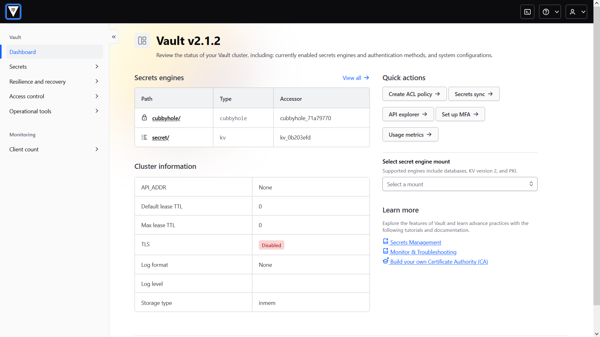
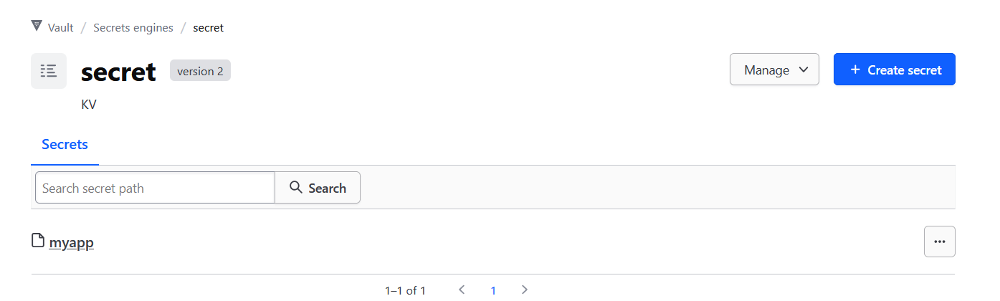
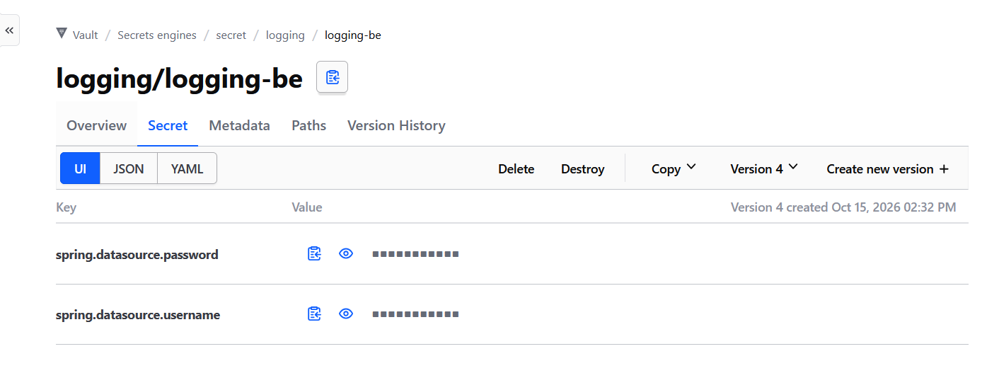

**Hashicorp Vault**

Hashicorp Vault là một giải pháp quản lý bí mật mã nguồn mở, giúp các tổ chức và doanh nghiệp bảo vệ thông tin bí mật, quản lý quyền truy cập vào dữ liệu nhạy cảm, và cung cấp khả năng tự động hóa vòng đời bí mật. Vault lưu trữ các dữ liệu nhạy cảm (secrets) như token, password, certificate, API keys, file .env, thông tin đăng nhập... trong một môi trường an toàn được mã hóa và cung cấp các chính sách kiểm soát truy cập chi tiết.

**Đặc điểm chính của Vault**

- Quản lý secret tập trung thay vì phân tán ở nhiều nơi, dễ dàng quản lý và kiểm soát, đồng thời giảm thiểu nguy cơ rò rỉ dữ liệu.
- Mọi secret đều được Vault mã hóa trong quá trình lưu trữ và vận chuyển.
- Quản lý quyền truy cập, ghi hay chỉnh sửa secret theo role.
- Mọi hành động truy cập hoặc thay đổi bí mật đều được Vault ghi lại.
- Vault tự động hóa việc cấp phát, gia hạn và thu hồi các secret, có thể tự động tạo ra các secret tạm thời cho các dịch vụ như thông tin đăng nhập DB, API key, chứng chỉ SSL... Khi ko còn cần thiết, các secret sẽ tự động bị thu hồi.

**Các thành phần chính:**

**Secret engine:** là nơi lưu trữ và quản lý các secret trong Vault. Mỗi secret engine hoạt động như một cơ chế lưu trữ riêng biệt, Vault hỗ trợ nhiều loại engine khác nhau để quản lý các loại secret khác nhau, một số loại đáng quan tâm:

- Key-value store: Secret engine phổ biến nhất, cho phép lưu trữ các cặp key-value đơn giản, phù hợp cho lưu trữ password, API key và các dữ liệu nhạy cảm khác.
- Database secret engine: Tự động tạo và quản lý các thông tin login tạm thời cho các DB như MySQL, PostgreSQL, hoặc MongoDB.
- PKI secret Engine: Tạo và quản lý các chứng chỉ SSL và các khóa liên quan, giúp tự động hóa quy trình cấp phát chứng chỉ cho hệ thống.
- Transit secret engine: cung cấp encryption as a service, cung cấp dịch vụ encryption và decryption thông qua API mà ko cần application trực tiếp giữ encryption key.
- Secret engine cho các dịch vụ cloud như AWS hay Azure: quản lý thông tin đăng nhập và quyền truy cập vào tài khoản cloud, bao gồm việc cấp phát khóa truy cập tạm thời.

**Phương thức xác thực**: Vault hỗ trợ nhiều phương thức xác thực khác nhau để cấp quyền truy cập cho người dùng. Một số loại phổ biến:

- Token: phương thức xác thực mặc định của Vault. User hoặc application sẽ nhận được một token, và token này sẽ được sử dụng để truy cập vào các bí mật.
- Userpass: đăng nhập bằng username và password.
- OIDC: SSO bằng Keycloak, Okta...

**Policy (chính sách)**: Vault sử dụng các chính sách để kiểm soát quyền truy cập vào các secret. Các chính sách này được xây dựng dựa trên ngôn ngữ HCL (HashiCorp Configuration Language) hoặc JSON và cho phép tổ chức thiết lập các quyền truy cập chi tiết cho từng bí mật.

**Audit device (thiết bị kiểm toán)**: Vault cung cấp khả năng theo dõi tất cả các hành động liên quan đến việc truy cập và quản lý secret thông qua các audit device, bao gồm việc ghi lại mọi hành động truy cập, thay đổi hoặc hủy secret. Các bản ghi kiểm toán này rất hữu ích trong việc theo dõi và phát hiện các hành vi bất thường, cũng như cung cấp thông tin cho các cuộc điều tra bảo mật nếu cần thiết.

**Setup Vault**

Có thể chạy Vault trực tiếp hoặc trong môi trường container. Trên Linux Ubuntu:

```
wget -O - https://apt.releases.hashicorp.com/gpg | sudo gpg --dearmor -o /usr/share/keyrings/hashicorp-archive-keyring.gpg
echo "deb [arch=$(dpkg --print-architecture) signed-by=/usr/share/keyrings/hashicorp-archive-keyring.gpg] https://apt.releases.hashicorp.com $(grep -oP '(?<=UBUNTU_CODENAME=).*' /etc/os-release || lsb_release -cs) main" | sudo tee /etc/apt/sources.list.d/hashicorp.list
sudo apt update && sudo apt install vault
```

rồi khởi động Vault ở chế độ dev:

```
vault server -dev
```

Một số đặc tính của dev mode:

- Đã khởi tạo và unsealed, ko cần thực hiện vault operator unseal.
- Data chỉ được chứa trong RAM, sẽ bị mất khi dừng hoặc restart Vault hay server.
- Chạy ở 127.0.0.1:8200, ko cần TLS.
- Đã setup authentication cơ bản, in token root ra terminal khi start up.

Setup thành công:



Tạo secret đầu tiên: có thể tạo trong UI hoặc qua terminal. Để tạo secret kiểu key-value trong terminal chạy VD:

```
vault kv put secret/myapp username=admin password=123456
```

- Lệnh ghi cặp dữ liệu dạng key-value vào trong Vault tại đường dẫn secret/myapp.
- kv: key-value secret engine
- secret/myapp là path tới secret ở trong vault. Trong vault có thể tạo các "thư mục" để 1 tệp có thể chứa nhiều secret tập trung. Đây được gọi là đường dẫn logic.
- các cặp key-value được định nghĩa bằng dấu "="



Đọc secret:

```
vault kv get secret/myapp # đọc toàn bộ secret
vault kv get -field=username secret/myapp # đọc 1 trường
```

Kết quả:

```
== Secret Path ==
secret/data/myapp

======= Metadata =======
Key                Value
---                -----
created_time       2026-10-15T03:07:17.674173158Z
custom_metadata    <nil>
deletion_time      n/a
destroyed          false
version            1

====== Data ======
Key         Value
---         -----
password    123456
username    admin
```

- Ngoài value của secret còn chứa các thông tin như thời gian tạo secret, thời gian sẽ xóa secret, trạng thái, phiên bản

Danh sách các engine đang chạy:

```
vault secrets list
```

```
Path               Type              Accessor                   Description
----               ----              --------                   -----------
agent-registry/    agent_registry    agent-registry_fc419613    agent registry
cubbyhole/         cubbyhole         cubbyhole_71a79770         per-token private secret storage
identity/          identity          identity_9926e40c          identity store
secret/            kv                kv_0b203efd                key/value secret storage
sys/               system            system_4ed014a1            system endpoints used for control, policy and debugging
```

**Thực hiện setup cơ bản dev mode cho backend sử dụng Spring Boot**

Thực hiện setup backend chạy Spring Boot để liên kết tới Vault đang chạy dev mode, authenticate bằng token root (Mục đích kiểm thử cách hoạt động):

Thêm Spring Cloud BOM và Spring Cloud Vault vào trong file pom.xml:

```
    <dependencyManagement>
        <dependencies>
            <dependency>
                <groupId>org.springframework.cloud</groupId>
                <artifactId>spring-cloud-dependencies</artifactId>
                <version>2025.0.3</version>
                <type>pom</type>
                <scope>import</scope>
            </dependency>
        </dependencies>
    </dependencyManagement>
```

và

```
    <dependency>
        <groupId>org.springframework.cloud</groupId>
        <artifactId>spring-cloud-starter-vault-config</artifactId>
    </dependency>
```

Trong application.properties:

```
spring.config.import=vault:// # Yêu cầu Spring nhập config từ vault khi khởi động

spring.cloud.vault.uri=http://127.0.0.1:8200 # Địa chỉ Vault server
spring.cloud.vault.authentication=TOKEN # Kiểu authentication
spring.cloud.vault.token=${VAULT_TOKEN} # Giá trị token (lấy từ file .env)

spring.cloud.vault.kv.enabled=true # Bật tích hợp key-value engine của Vault
spring.cloud.vault.kv.backend=secret # Xác định tên mount của KV Engine trong Vault.
spring.cloud.vault.kv.default-context=logging/logging-be # Xác định context mặc định mà Spring Cloud Vault dùng để tìm cấu hình trong KV engine.
```

VD muốn cất credential đăng nhập DB trong Vault, chạy lệnh sau để add các secret vào engine:

```
vault kv put secret/logging/logging-be spring.datasource.username=root spring.datasource.password=root
```

Restart các ứng dụng và nếu setup thành công thì ứng dụng sẽ nhận diện được Vault thành công và lấy các secret từ đó.



**Version**: mỗi lần thêm key-value mới vào một path bằng lệnh kv put thì những cặp key-value đó sẽ thay thế những cặp cũ để thành version mới. Nếu muốn version mới nhất có đầy đủ các cặp KV thì cần thêm vào cùng một lúc. Ngoài ra người dùng có thể rollback phiên bản secret:

```
vault kv rollback -mount=<mount_path> -version=<target_version> <secret_path>
```

Rollback chỉ áp dụng cho KV secret engine version 2, ko cho v1. Nếu cần cập nhật secret có thể sử dụng:

```
vault kv patch -mount=secret logging/logging-be DB_PASSWORD=newpassword
```

Thêm 1 số lệnh cơ bản:

```
vault kv get -mount=secret logging/logging-be # Lấy các secret trong 1 path
vault kv delete -mount=secret logging/logging-be # Xóa secret
vault kv delete -mount=secret -versions=4 logging/logging-be # Xóa tạm thời 1 secret. Trong Vault khi xóa mặc định sẽ là xóa tạm thời.
vault kv undelete -mount=secret -versions=4 logging/logging-be # Khôi phục secret.
vault kv destroy -mount=secret -versions=4 logging/logging-be # Xóa vĩnh viễn secret
vault kv list -mount=secret logging/ # Liệt kê secret
vault kv metadata delete -mount=secret logging/logging-be # Xóa toàn bộ secret và metadata (những thông tin version...)
```